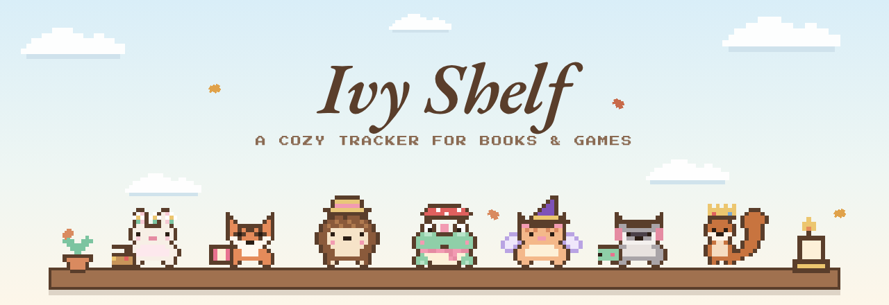
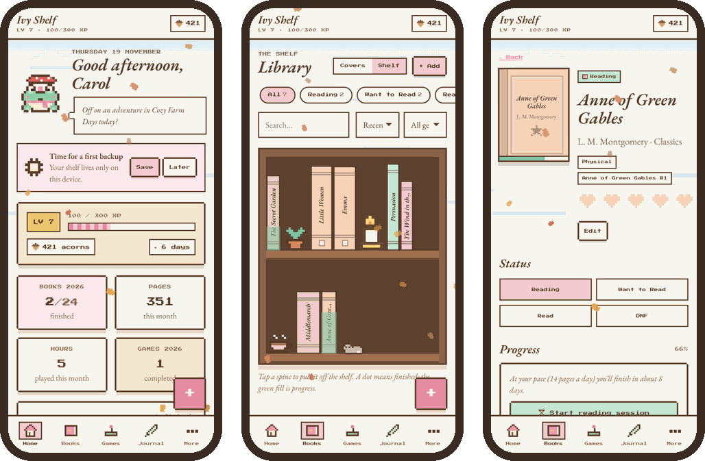
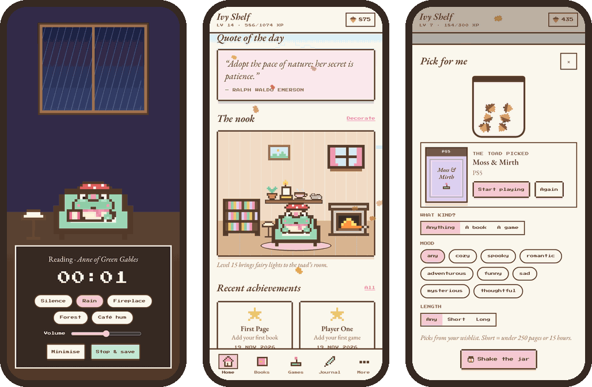
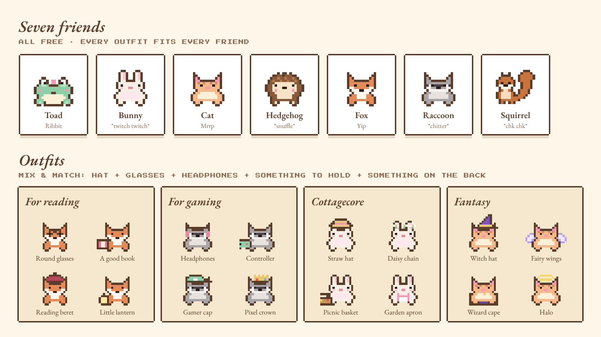
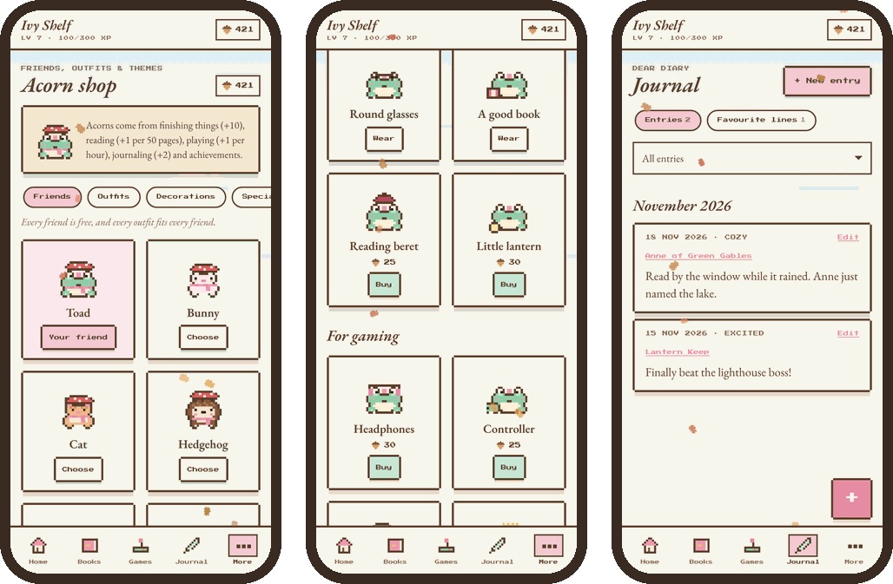
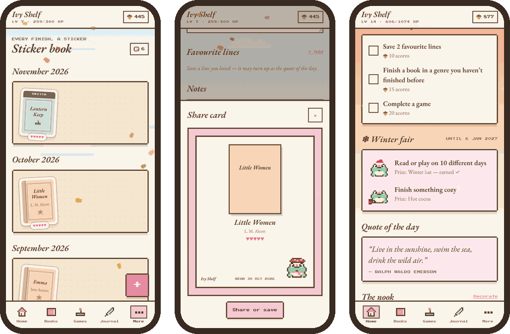
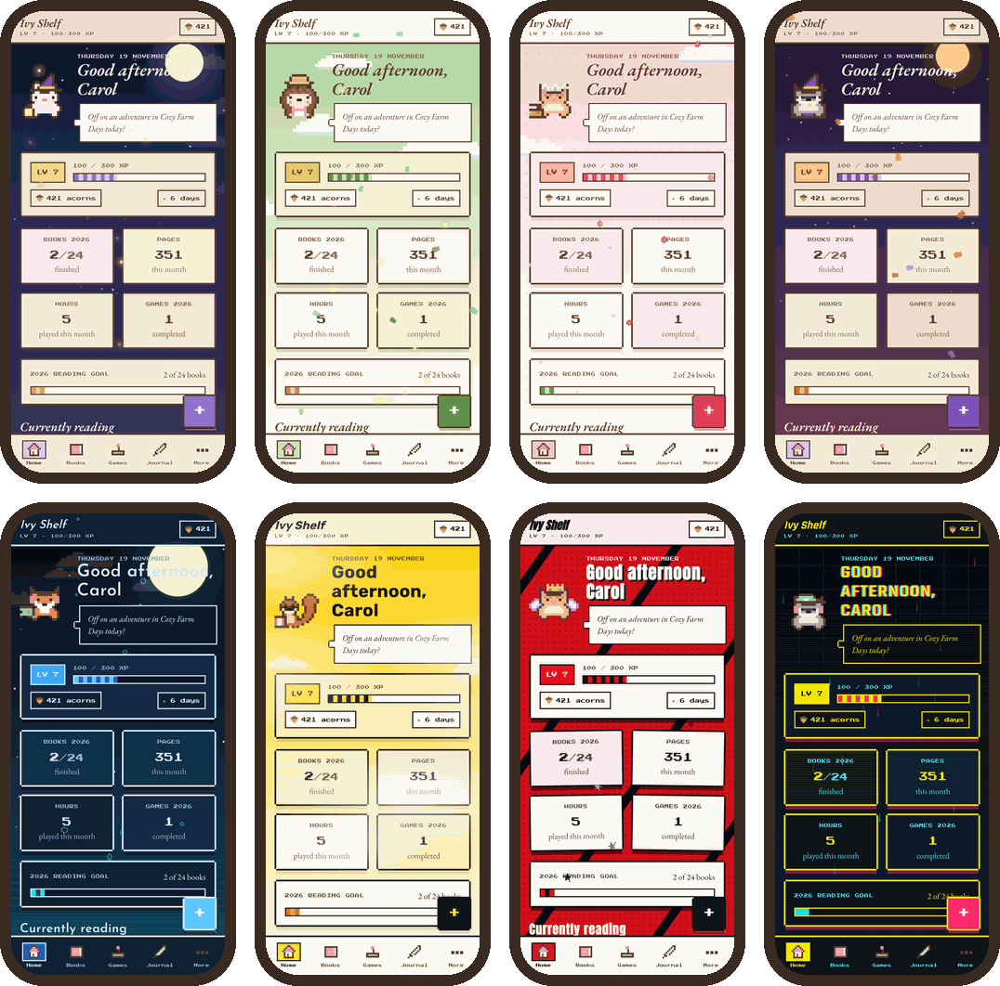
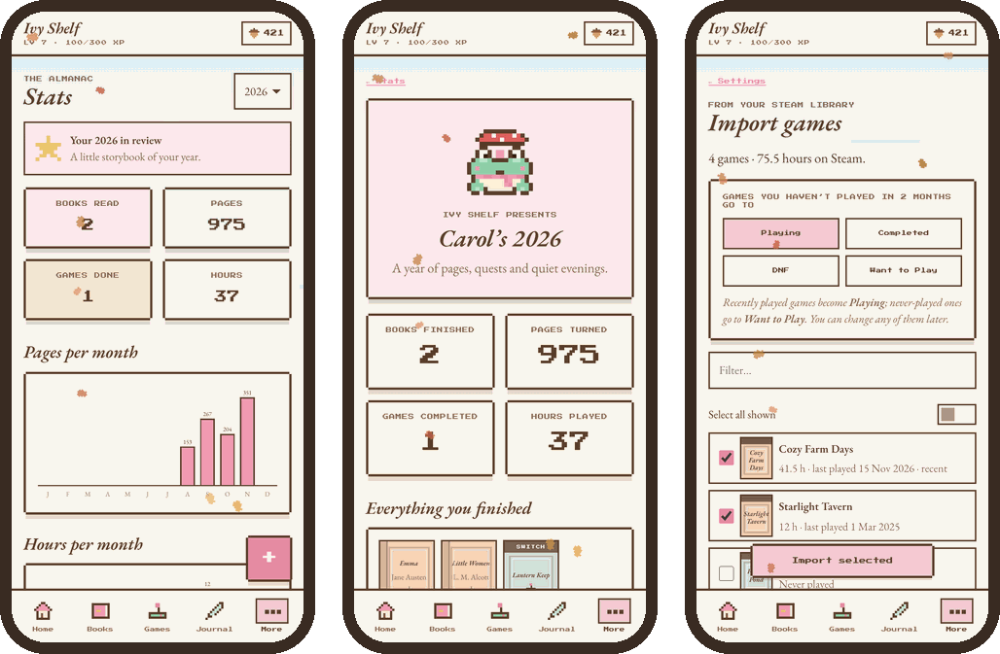
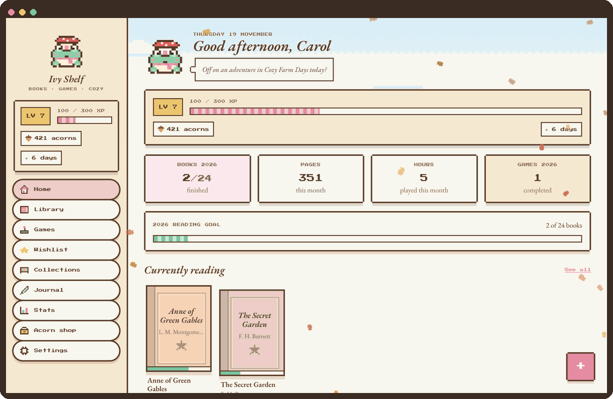

<p align="center">
  
</p>

<p align="center">
  <b>A cozy, pixel-art tracker for the books you read and the games you play.</b><br>
  <i>Pages and hours, hearts and reviews, a journal, a shop full of tiny hats, and seven little friends to keep you company.</i>
</p>

<p align="center">
  <a href="https://caro1ferreira.github.io/hollow-shelf/hollow-shelf/"><b>✿ Open Ivy Shelf ✿</b></a>
  &nbsp;·&nbsp; <a href="#-put-it-on-your-iphone">Install on iPhone</a>
  &nbsp;·&nbsp; <a href="#-changelog">What's new</a>
</p>

---

## 📚 Track everything

<p align="center"></p>

- **Books and games side by side.** Statuses are *Want to Read / Reading / Read / DNF* for books and *Want to Play / Playing / Completed / DNF* for games.
- **Progress.** Track pages for books and hours for games, with quick +10 pages / +1h buttons and a progress ribbon on every cover.
- **Timed sessions.** Tap *Start session*, read or play, then tap *Stop*. The pages or hours are logged for you.
- **Pace forecasts.** "At your pace you'll finish in about 8 days."
- **Formats, series and moods.** Mark books as physical, e-book, audiobook or comic; track series ("#3, next up: #4"); tag moods like *cozy*, *spooky* or *romantic*.
- **Lending tracker.** Note who borrowed which book, with a *Lent out* filter so nothing goes missing.
- **Covers that find themselves.**
  - Books: search by title, author or ISBN (Open Library, with Google Books as a fallback), or scan the barcode with your camera. *Other editions* lets you pick the exact cover you own.
  - Games: search by name for real cover art, platform, genre and an estimated time to beat (IGDB). You can also paste a Steam link.
- **Steam sync.** Import your Steam library, and your playtime **and achievements** update by itself once a day. Get every achievement and the game is **Mastered**.
- **Bring your history.** Import a CSV from **Goodreads** or **StoryGraph**, with ratings, dates, series, formats and moods.
- **Two ways to browse.** Use a cover grid, or a wooden **bookshelf** with spines you can pull off the shelf.
- **Hearts, not stars.** Rate from 0 to 5 hearts. Reviews unlock only once you've finished something.
- **Wishlist, collections and favourite lines.** Your saved quotes turn up as the *quote of the day*.

## 🕯 The reading room

<p align="center"></p>

- **Reading room.** Start a session and the screen becomes a quiet scene: your friend curled up in an armchair, rain on the window and a big pixel clock. You can add **ambient sound** (rain, fireplace, forest or café hum), all generated in the app.
- **Your friend's room.** As you level up, the room fills in: a rug, a window, a painting, a bookcase, a lamp, an armchair, a fireplace, fairy lights and a big plant.
- **Pick-for-me jar.** Can't choose? Shake a jar of acorns and your friend picks something from your wishlist. You can filter by book or game, mood and length.

## 🐸 Friends, outfits and the acorn shop

<p align="center"></p>

Finishing books and games, logging pages and hours, journaling and unlocking achievements all earn **XP** and **acorns** 🌰. Spend them in the shop:

- **7 friends, all free:** toad, bunny, cat, hedgehog, fox, raccoon and squirrel. Every outfit fits every friend.
- **22 outfit pieces:** classics, plus sets *for reading*, *for gaming*, *cottagecore* and *fantasy*. Mix them up: a hat, glasses, headphones, something to hold and something on your back.
- **Decorations** for the nook and the bookshelf, **colour themes**, and **companions** that wander along the bottom of the screen. You can pet them.

Your friend reacts to you. It cheers with confetti when you finish something, asks how your current book is going, and falls asleep if you've been away for a few days.

<p align="center"></p>

## 🎁 Collect, share and celebrate

<p align="center"></p>

- **Sticker book.** Every finish drops a die-cut sticker into a scrapbook, month by month.
- **Share cards.** Turn any book or game into a pretty image card with the cover, your hearts, a favourite line and your friend. Share it straight to stories or messages.
- **Monthly quests.** Three small goals each month ("read on 7 different days", "finish something under 200 pages"…). Claim them for bonus acorns.
- **Seasonal events.** Limited prizes you earn by playing along: a pumpkin hat in *Spooky season*, a winter hat and hot cocoa at the *Winter fair*, a blossom crown in *Spring bloom*, and a sun hat and ice cream in *Summer days*.
- **Gentle reminders.** A nudge on the home screen when it's been a while since your last backup.

## 🎨 Special themes

<p align="center"></p>

All free. Each theme changes the sky, palette, fonts and weather.

| Theme | Mood |
|---|---|
| **Moonlit library** | Midnight blue, a big moon, stars and drifting candle-glow |
| **Enchanted forest** | Moss greens, falling leaves, fireflies |
| **Strawberry field** | Soft reds, petals and little strawberries tumbling down |
| **Autumn witch** | Plum dusk, a harvest moon, purple and orange leaves |
| **Midnight hour** | Deep blue and teal, a huge pale moon, bubbles rising like you're underwater |
| **Foggy town** | Bright retro yellow, rolling fog, old-TV scanlines |
| **Phantom heart** | Red, black and white, halftone dots, diagonal slashes, tilted collage cards |
| **Neon city** | Black grid, acid yellow and cyan, neon rain, glitchy headings |

Outside the special themes, the default sky **follows the time of day**: rosy mornings, blue afternoons, golden sunsets and a starry night mode. The **seasons** bring their own weather too (leaves in autumn, snow in winter, petals in spring, fireflies on summer nights).

> The last four themes are fan tributes to the colour moods of *Persona 3*, *Persona 4*, *Persona 5* and *Cyberpunk 2077*. They use only colour, atmosphere and type; there are no logos, characters or game assets. This project is not affiliated with Atlus, SEGA or CD PROJEKT RED.

## 📈 Stats and your year in review

<p align="center"></p>

- Pages and hours per month, books and games finished, favourite genres, hours by platform, streaks and a yearly reading goal.
- **21 achievements**, levels and XP.
- **Reading calendar.** Each day you read or play fills in a square, and your biggest days bloom pink.
- **Year in review:** a little storybook of your year, with favourites, the big one, most played, the busiest month and a line you loved.

## 💻 On your computer too

<p align="center"></p>

On a big screen, the bottom tabs become a sidebar of pixel clouds. In Chrome or Edge you can **install** it as its own window.

---

## 📱 Put it on your iPhone

1. Open **[the app](https://caro1ferreira.github.io/hollow-shelf/hollow-shelf/)** in **Safari**.
2. Tap **Share → Add to Home Screen**.
3. Always open it from the icon. On iPhone, the home-screen app and Safari keep separate data.

It works offline once it's installed. Sounds play only when the silent switch is off.

## 🔒 Your data

- Everything lives **on your device**, in the browser's storage. Nothing is stored on GitHub or any server.
- Anyone who opens the link gets their own empty shelf. Nobody sees yours.
- Use **Settings → Save backup** now and then, for example to iCloud Drive. *Restore backup* moves your shelf to another device.

## 🛠 How it's built

| Piece | What it uses |
|---|---|
| App | A single-page **PWA** in plain HTML, CSS and JavaScript, with no build step. Data lives in **IndexedDB** and a service worker keeps it working offline. |
| Pixel art | Original sprites drawn in code as SVG (`js/sprites.js`). Outfits use anchor points so they fit every friend. |
| Book data | [Open Library](https://openlibrary.org/developers/api), with [Google Books](https://developers.google.com/books) as a fallback |
| Barcodes | [html5-qrcode](https://github.com/mebjas/html5-qrcode) (Apache-2.0), bundled in `lib/` |
| Game data | [IGDB](https://api-docs.igdb.com/) and the [Steam Web API](https://steamcommunity.com/dev) (library, playtime, achievements), reached through a tiny **Cloudflare Worker** that keeps the keys secret (`server/worker.js`) |
| Sound | Ambient soundscapes and UI sounds are synthesised live with the Web Audio API, with no audio files |
| Import | Goodreads and StoryGraph CSV exports, parsed on your device |
| Hosting | GitHub Pages |

```
hollow-shelf/
├── hollow-shelf/          ← the app (served by GitHub Pages)
│   ├── index.html         ← layout + all styles and themes
│   ├── js/app.js          ← screens, data, shop, stats, sync
│   ├── js/sprites.js      ← every pixel sprite: friends, outfits, room, icons, weather
│   ├── js/features.js     ← reading room, jar, import, stickers, share cards, quests, events
│   ├── sw.js              ← offline support
│   ├── manifest.webmanifest, icons/
│   └── lib/               ← barcode scanner
├── server/worker.js       ← helper server for game search + Steam
└── docs/readme/           ← images for this page
```

### Running your own helper server

Game search and Steam sync need the small worker in `server/worker.js`:

1. Create a Worker on Cloudflare and paste in the code.
2. Under **Settings → Variables and Secrets**, add these as *Secrets*: `STEAM_API_KEY`, `TWITCH_CLIENT_ID` and `TWITCH_CLIENT_SECRET`. The last two come from a Twitch developer app, which gives access to IGDB.
3. In Ivy Shelf, go to **Settings → Games & Steam**. Paste the worker address and your Steam profile link, then tap *Test connection*.

To accept calls from a different site, edit `ALLOWED_ORIGINS` at the top of the worker.

---

## 📝 Changelog

**v4 · 19 Nov 2026: The reading room**
- **Reading room** for timed sessions, with synthesised ambient sound (rain, fireplace, forest, café hum).
- **Friend's room** that grows as you level up, from a rug at level 2 to a big plant at level 20.
- **Pick-for-me jar**, with mood and length filters.
- **Goodreads and StoryGraph import**. Imported history fills your stats but doesn't earn XP or acorns.
- **Formats, series, mood tags and lending tracker.**
- **Steam achievements**, with a *Mastered* badge at 100%.
- **Pace forecasts**, **sticker book**, **share cards**, **monthly quests**, **seasonal events** with prize outfits, a **reading calendar**, and **backup reminders**.
- Fix: stopping a session from the reading room now shows the save dialog.

**v3 · 19 Nov 2026: Friends, outfits and special themes**
- Six new friends (bunny, cat, hedgehog, fox, raccoon, squirrel), all free, and every outfit fits all of them.
- Sixteen new outfit pieces in reading, gaming, cottagecore and fantasy sets. Pieces now combine across slots.
- Eight free special themes, each with its own sky, palette, fonts and weather.
- Theme-aware colours everywhere, so dark themes stay readable.
- This illustrated README.

**v2.2 · 17 Nov 2026: Games and Steam**
- Game search by name with real cover art, genre, synopsis and time to beat (IGDB).
- Steam library import with smart statuses, and a daily playtime sync.
- A tiny Cloudflare Worker keeps the API keys secret.
- Personal defaults removed, so anyone can open the link and start fresh.

**v2.1 · 17 Nov 2026: Renamed to Ivy Shelf** (it used to be *Ivy & the Hollow Shelf*)

**v2 · 17 Nov 2026: The cozy update**
- Acorn shop with toad outfits, decorations, colour themes and companions.
- Bookshelf view, barcode scanning, timed sessions, favourite lines and year in review.
- Sky that follows the time of day, seasonal weather, toad reactions and sounds.

**v1 · 17 Nov 2026: First shelf**
- Books and games with statuses, progress, hearts and reviews.
- Automatic book covers, editions, journal, collections, wishlist, stats, XP and achievements.
- Installable on iPhone, works offline, with backup and restore.

## 🌱 Roadmap

- [ ] **Sync between devices**, so the same shelf is on your phone and your computer (Supabase)
- [ ] **Hand-drawn pixel art**, replacing the code-drawn sprites with original artwork
- [ ] More friends, outfits and themes as ideas bloom

## 💌 Credits

Book data from **Open Library** and **Google Books**. Game data and cover art from **[IGDB.com](https://www.igdb.com)**. Playtime from the **Steam Web API**.
Fonts: EB Garamond, Press Start 2P, Josefin Sans, Rubik, Anton and Rajdhani, all via Google Fonts under the SIL Open Font License.
Barcode scanning: html5-qrcode (Apache-2.0). The *quote of the day* uses public-domain quotes.
Built with care by Carol, with help from Claude.
